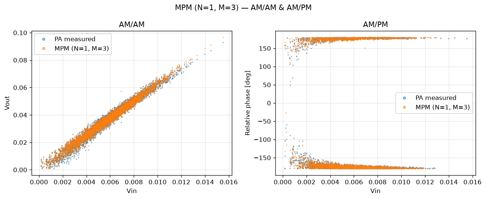
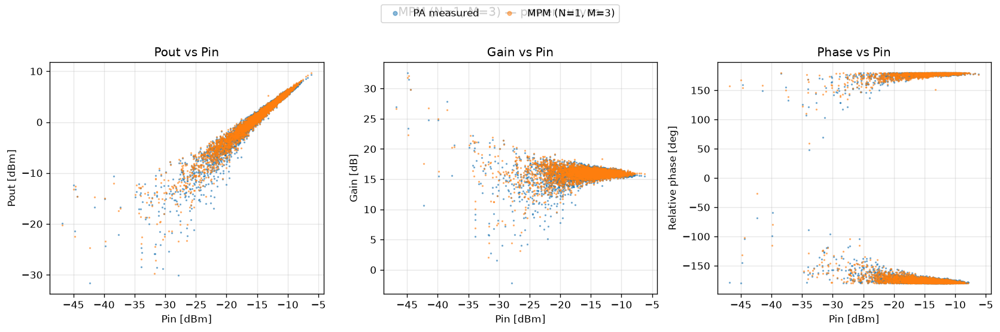
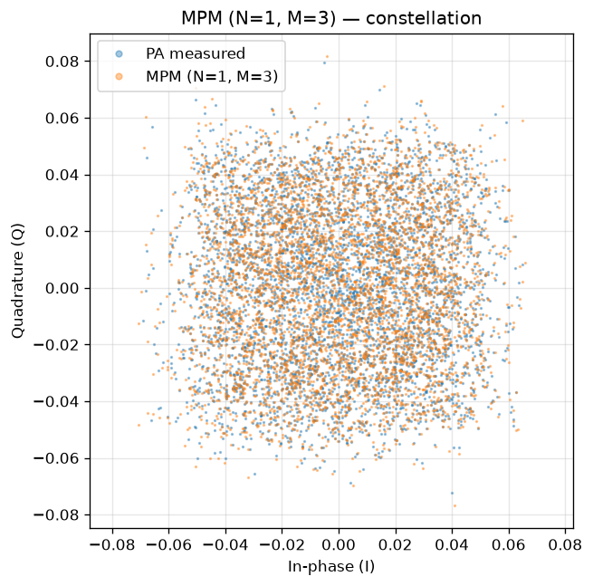
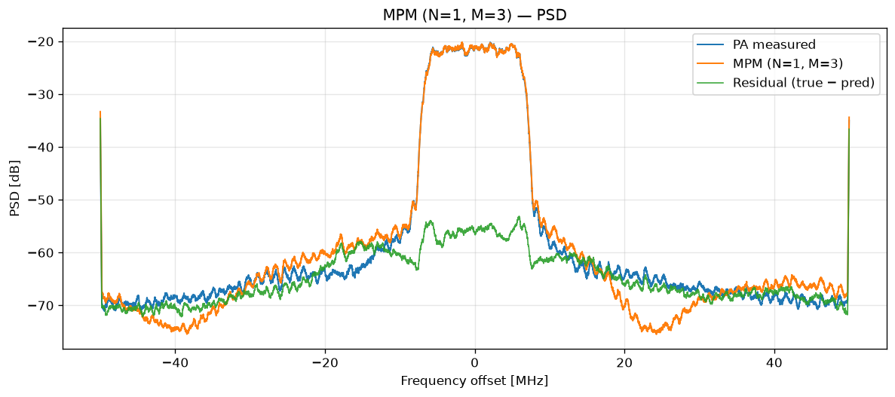

# ampbench

Behavioral modeling toolkit for **RF power amplifiers**.

Digitized PA curves and complex baseband captures → classical models (**MPM**, **Hammerstein**, **Wiener**) and an **ANN** with memory → NMSE metrics → honest evaluation figures (no cosmetic plot hacks).

> Ready to publish — see [`docs/PUBLISH_CHECKLIST.md`](docs/PUBLISH_CHECKLIST.md).

| | |
|---|---|
| **Language** | Python 3.10+ |
| **License** | MIT (code) |
| **Author** | Miguel Angel Chiri Yupanqui |
| **Related paper** | [JBC 20(55)](https://revistas.univalle.edu/index.php/ciencias/article/view/1101) · DOI [10.52428/20758944.v20i55.1101](https://doi.org/10.52428/20758944.v20i55.1101) |

## Why this project

This repo packages thesis/research code into a reproducible toolkit:

1. **Data** — four digitized amplifiers + a QAM-256 I/Q drive dataset  
2. **Models** — memory polynomial family + Keras ANN  
3. **Eval** — NMSE on complex baseband + AM/AM, AM/PM, PSD, constellation plots  

Manufacturer datasheet PDFs are **not** redistributed (copyright). Numerical extracts you own are under `data/`.

## Example results (MPM)

Generated with:

```bash
python scripts/evaluate_and_plot.py --model MPM --order 1 --memory 3 --max-train 4000
```

| AM/AM & AM/PM | Power curves |
|---|---|
|  |  |

| Constellation | PSD |
|---|---|
|  |  |

## Repository layout

```text
ampbench/
  data/raw/<amp_id>/          # Vin, Vout, phase curves (4 PAs)
  data/processed/iq_qam256/   # dataset + train/valid/test splits
  src/ampbench/               # installable package
    data/  metrics/  models/  plotting/
  scripts/                    # CLI entrypoints
  docs/                       # data policy, reproducibility, figures
  legacy/                     # original thesis scripts (deprecated)
  artifacts/                  # runtime outputs (gitignored)
```

## Install

```bash
python -m venv .venv
# Windows:
.venv\Scripts\activate
# Linux/macOS:
# source .venv/bin/activate

pip install -U pip
pip install -e ".[ann]"    # full stack (includes TensorFlow)
# or classical-only:
# pip install -e .
```

Classical models need NumPy/SciPy only. TensorFlow is required for `scripts/train_ann.py`.

## Quick start (reproducible path)

```bash
# 1) Sanity checks
python scripts/inspect_amplifiers.py
python scripts/smoke_check_data.py
python scripts/smoke_check_models.py

# 2) Train a classical baseline
python scripts/train_traditional.py --model MPM --order 1 --memory 7

# 3) Metrics + figures (saved under artifacts/eval/, no popup windows)
python scripts/evaluate_and_plot.py --model MPM --order 1 --memory 7

# 4) Optional ANN
python scripts/train_ann.py --epochs 50
```

Expected smoke-check behavior: all four amplifiers load; I/Q dataset shape `(24576, 5)`; MPM/Hammerstein/Wiener return finite `nmse_db` on a short subsample.

More detail: [`docs/REPRODUCIBILITY.md`](docs/REPRODUCIBILITY.md) · data catalog: [`docs/DATA.md`](docs/DATA.md).

## Amplifiers included

| ID | Device | Notes |
|----|--------|-------|
| `tga2595` | Qorvo TGA2595 | Primary 5G PA from the degree project |
| `k_hpa10w_1721` | ReliaSat K-HPA10W-1721-SSPA | ~19.5 GHz (workbook) |
| `q_hpa2w_3743` | Q-HPA2W-3743 | ~37 GHz (workbook) |
| `hpa11201721qf` | HPA11201721QF | ~20 GHz (workbook) |

Raw curve previews: [`docs/figures/`](docs/figures/).

## Design rules (evaluation honesty)

- Plots are **opt-in** (`show=False` by default); prefer saving PNGs.
- Constellations show **raw I/Q** (no random jitter).
- PSD residuals are `PSD(y_true - y_pred)` with **no** cosmetic gain/offset.
- Plot helpers do **not** silently write CSV/pickle side products.

See [`docs/KNOWN_ISSUES.md`](docs/KNOWN_ISSUES.md).

## Citation

If you use this code or the underlying study, please cite:

```bibtex
@article{Chiri2024PA5G,
  author  = {Chiri Yupanqui, Miguel Angel},
  title   = {Modeling the Behavior of a Power Amplifier for 5G Using Machine Learning},
  journal = {Journal Boliviano de Ciencias},
  year    = {2024},
  volume  = {20},
  number  = {55},
  pages   = {6--14},
  doi     = {10.52428/20758944.v20i55.1101},
  url     = {https://revistas.univalle.edu/index.php/ciencias/article/view/1101}
}
```

## License

- **Code:** MIT — see [`LICENSE`](LICENSE).
- **Datasheets / manufacturer PDFs:** remain with their respective copyright holders (kept only in local `_local_only/`, not published).
